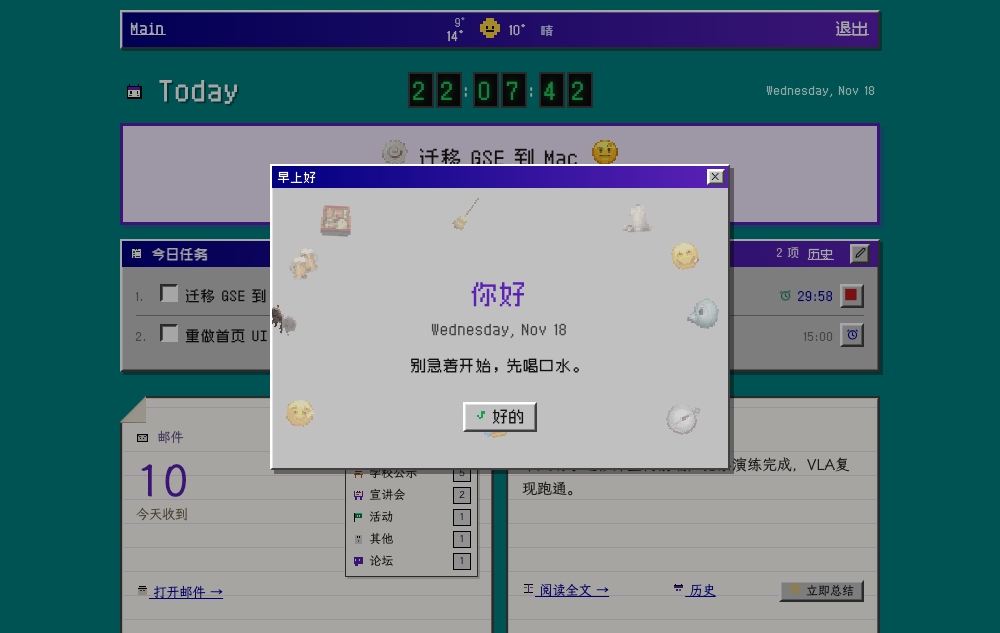
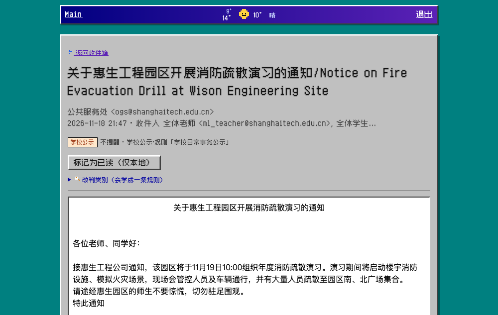
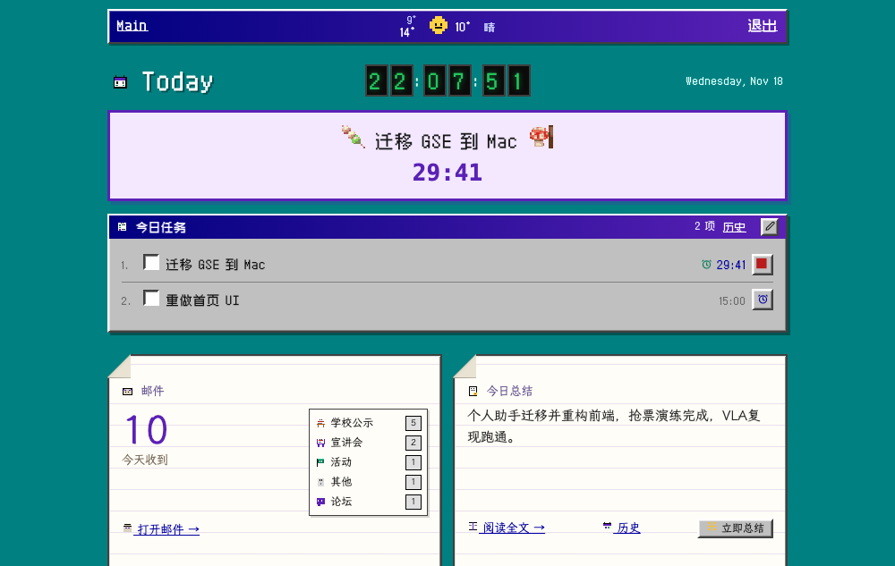
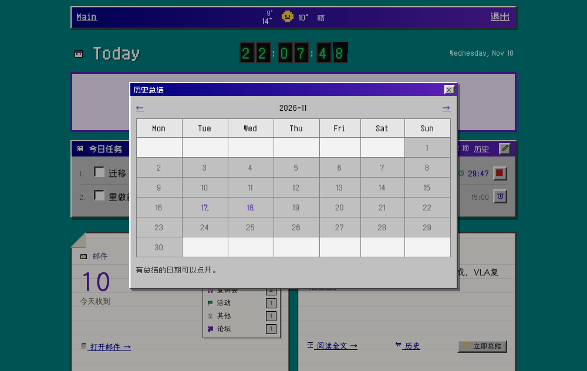

# your-assistant

> 本地优先的个人助手：只读邮件归档、任务倒计时、每日复盘，全部跑在自己的电脑上，用像素风网页看。

<p align="center">
  
</p>

## 特性

- **只读邮件**：只做 `SELECT (readonly)` / `UID SEARCH` / `BODY.PEEK`，没有 SMTP/POP3，不会替你发信或删信
- **7 类归档**：论文/导师、活动、宣讲会、论坛、学校公示、广告、其他，可手动改判并学成规则
- **重要邮件提醒**：论文/导师类立即提醒并反复追问，活动提醒一次，其余不打扰
- **今日任务**：一行一条，倒计时 25 分钟（可改），归零弹「休息一下」，支持继续正计时
- **每日复盘**：20:00 汇总当天 pi/codex 会话，提炼纠错规则，写进 `vault/reviews/`
- **资料索引**：Markdown 笔记 jieba 分词 + SQLite FTS5，回答带 `path:line`
- **像素风 Web**：Win98 窗口、A4 纸卡片、翻牌时钟、可拖拽排序、像素 emoji
- **本地优先**：所有数据在 `vault/`、`data/`、`memory/`，默认只监听 `127.0.0.1`

## 截图

| 首页（任务卡 / 像素 emoji） | 邮件详情（HTML + 内嵌图） |
| --- | --- |
|  |  |

| 每日问候 | 历史总结日历 |
| --- | --- |
|  |  |

## 快速开始

需要 Python 3.12 和 [uv](https://docs.astral.sh/uv/)。

```bash
git clone git@github.com:Hiaa1/your-assistant.git
cd your-assistant
uv sync --locked --group dev

cp .env.example .env && chmod 600 .env
# 填 ASSISTANT_EMAIL_ADDRESS / ASSISTANT_EMAIL_PASSWORD
# 填 ASSISTANT_PASSWORD / ASSISTANT_SESSION_SECRET

uv run your-assistant doctor --net   # 检查目录、IMAP、LLM
uv run your-assistant index          # 索引 vault/
uv run your-assistant sync           # 只读拉一次邮件
uv run your-assistant serve          # 打开 http://127.0.0.1:8000
```

手机访问需要显式授权：`uv run your-assistant serve --allow-lan`，然后用
`uv run your-assistant link --allow-lan` 打印带 key 的链接。

## 真实使用方式

这是我自己每天在用的几个场景，不是演示数据：

1. **早上打开**：6 点后第一次进首页会弹问候，告诉你日期、节日和一句不咸不淡的祝福，四周散着随机像素图标。
2. **看未读**：邮件卡片只显示今天收到的数量和分类，点开是完整 HTML 正文，内嵌图片直接显示；读过的邮件本地和服务器都会标已读。
3. **开始干活**：点任务前的闹钟，Today 下面出现紫色焦点卡，两边是随机像素 emoji，倒计时结束弹「休息一下」。
4. **中午/晚上**：任务累计时间、完成勾选都写进 `vault/tasks/YYYY-MM-DD.md`，第二天 00:05 自动归档到 `vault/tasks/archive/YYYY-MM.md`。
5. **每天 20:00**：自动读本机和 2404 上的 pi/codex 会话，生成复盘和纠错案例；也可以点「立即总结」手动触发，带阶段进度条。
6. **写东西**：`vault/blog/*.md` 放文章，首页会出现博客卡片；草稿先放 `vault/blog/_drafts/`，不进列表。

## 目录结构

```
src/your_assistant/
  config.py     环境变量 → Settings
  web.py        FastAPI 路由、模板、会话
  mail.py       邮件仓库 + 规则分类
  imap.py       只读 IMAP 适配器
  tasks.py      今日任务、倒计时、归档
  knowledge.py  Markdown 索引与检索
  review.py     每日复盘
  agentlog.py   pi/codex 会话解析
  blog.py       博客文章
  weather.py    天气（wttr.in，10 分钟缓存）
  templates/    Jinja2 模板
  static/       CSS、字体、像素 emoji
vault/          个人内容：笔记、博客、复盘（不进 Git）
memory/         纠错案例（不进 Git）
data/           SQLite、邮件缓存（不进 Git）
```

个人内容与代码的边界、分发方式、自建仓库步骤见 [DISTRIBUTE.md](DISTRIBUTE.md)。

## 配置

所有配置走环境变量，见 `.env.example`。常用：

| 变量 | 说明 |
| --- | --- |
| `ASSISTANT_EMAIL_ADDRESS` / `ASSISTANT_EMAIL_PASSWORD` | 学校邮箱与客户端专用密码 |
| `ASSISTANT_PASSWORD` | Web 登录密码 |
| `ASSISTANT_SESSION_SECRET` | 登录 cookie 签名密钥 |
| `ASSISTANT_ALLOW_LAN` | 是否允许局域网访问，默认 false |
| `ASSISTANT_MARK_SEEN_REMOTE` | 读邮件时是否同步服务器已读（写操作） |
| `ASSISTANT_MAIL_INTERVAL_SECONDS` | 邮件同步间隔，默认 300 |
| `ASSISTANT_LLM_MODEL` / `ASSISTANT_LLM_API_KEY` | 模型配置，默认复用 pi 的 deepseek |

## 开发

```bash
uv run --locked ruff check .
uv run --locked ruff format --check .
PYTEST_DISABLE_PLUGIN_AUTOLOAD=1 uv run --locked pytest
```

CI 在 `.github/workflows/ci.yml`，跑同样的三条。

## 已知限制

- 没有发送邮件、删除邮件、回复草稿（`ports.py` 里留了 `MailSender` 接缝）
- 提醒只在站内，没有推送通道（`Notifier` 端口预留）
- 分类规则是从我自己的邮件推断的，换人需要改 `rules/mail_rules.yaml`
- 没有向量检索，只有 FTS5 关键词

## 许可

MIT
